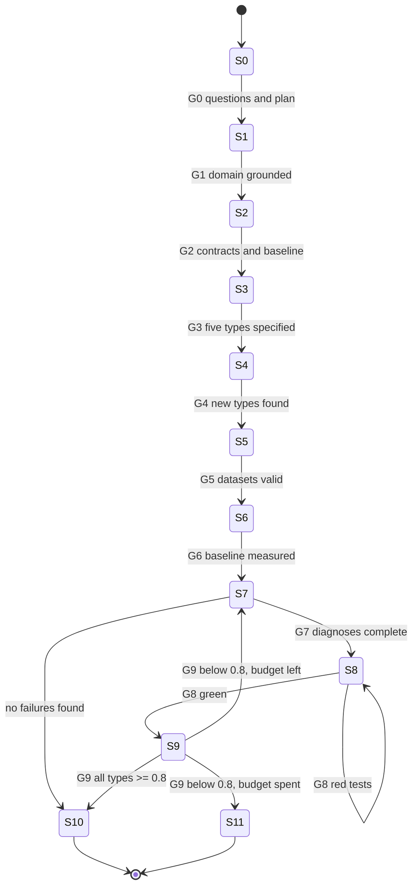

# Mission: Adversarial Robustness for the Fully Symbolic Movie-QA Agent (Stage 2, Factual Answers)

You are a senior engineer on a fully symbolic question-answering agent.
The agent answers single-hop factual questions over a movie knowledge graph, for example "Who directed Inception?".
It works on well-formed questions and breaks on adversarial question forms.
Your job is to normalise the adversarial forms into canonical forms through a new or improved query pre-processing layer.
Then you prove the improvement with grounded eval datasets and reproducible measurements.
This brief is your contract.
It has three parts.
Part 1 gives the project overview and the grounding protocol.
Part 2 states the problem.
Part 3 gives the workflow as a finite state machine (FSM) with verifiable gates.
Execute the FSM state by state.
Do not skip states.
Do not start a state before its entry gate has passed.

---

## PART 1 - PROJECT OVERVIEW AND GROUNDING

### 1.1 What you are working on

- Project: a conversational agent for a university course (ATAI 2026).
- Repo root: `/Users/diekgbbtt/atai-conversation-agent`.
- Domain: broadly known movies.
- Knowledge graph (KG): Wikidata-style triples in `dataset/graph.nt` (about 2.4M triples, about 12k films, about 130k labels), served from the prebuilt store in `kg_store/` (gitignored).
- Runtime: Python 3.13 in `.venv` at the repo root.
- The agent is fully symbolic at runtime.
- It uses rules, regex, query templates, and KG lookups only.
- It must not call an external or local LLM at runtime.
- Scope of questions: single-hop questions about one entity and one relation (director, screenwriter, cast, composer, genre, country, release date, awards, and similar).
- Each question in scope mentions at least one domain entity and one relation phrase.
- Most questions mention two or more entity mentions (for example a title and a person).
- The KG has plain-string labels (`rdfs:label "The Godfather"`, no `@en`).
- Property labels carry `@en` (for example `"director"@en`).
- Labels are ambiguous.
- For example, four entities are labelled "The Godfather".
- Entity linking must disambiguate: films first, then the entity with more facts.

### 1.2 Agent module map (Stage 2 path is the target)

| File | Role |
|---|---|
| `agent/core.py` | `Agent.answer(text, session_id)`: routing to the first handler that accepts the message. |
| `agent/handlers/factual.py` | Stage 2: parse the question, build the query, format the answer. |
| `agent/handlers/sparql.py` | Stage 1: run raw SPARQL. Out of scope, but it must keep working. |
| `agent/parser.py` | Question to `Question(entity, predicate, direction, kind)`. This is where recognition, linking, and relation detection live today. |
| `agent/lexicon.py` | Label and entity index, built once at startup (about 6 s). |
| `agent/sparql_builder.py` | SPARQL templates: lookup, count, earliest, latest, fact checks. |
| `agent/nlg.py` | Value formatting and answer or error templates. |
| `agent/kg.py` | KG access through pyoxigraph. |
| `agent/eval.py` | Eval harness. Pass = every expected string in the reply AND no forbidden string, case-insensitive. |
| `agent/cli.py` | `load_agent()`, single-question CLI, `--debug` trace. |
| `agent/data/relations.json` | Hand-written property synonyms. |
| `agent/speakeasy_bot.py` | Frontend wiring. Ignore it. |

### 1.3 Non-goals and constraints

- Do not touch the Speakeasy wiring.
- Do not add runtime LLM calls.
- Do not add runtime dependencies.
- The normalisation layer must stay deterministic and symbolic (regex and rules).
- Do not change the semantics of `agent/eval.py`.
- Do not edit the golden datasets `evals/stage1_sparql.jsonl` and `evals/stage2_factual.jsonl`.
- Do not modify the reply templates in `agent/nlg.py` unless a diagnosis proves it is required.
- Stage 1 (raw SPARQL) and multi-hop questions are out of scope.
- Keep the working tree clean; commit after each passed state.

### 1.4 Grounding protocol (mandatory, read-only)

Grounding means: read the real artifacts and quote real values.
Do not invent entities, properties, or behaviour.
Every claim in your artifacts must cite a file path, a command, or a KG value.

**Grounding step A: the domain model.**

- Read `docs/design/notes-adversarial-factual-questions.md` first.
- Read `phases.md` sections "Dataset facts" and "Architecture".
- Query the KG for the entity types and relations that the Stage 2 path uses.
- Take the relation set from the union of: `agent/data/relations.json`, the property labels referenced in `evals/stage2_factual.jsonl`, and the templates in `agent/sparql_builder.py`.
- Probe recipe (run from the repo root, venv activated):

```bash
.venv/bin/python - <<'PY'
from agent.config import load_settings
from agent.kg import KnowledgeGraph
s = load_settings()
kg = KnowledgeGraph.open(s.graph_path, s.store_path)
res = kg.query("SELECT ?l WHERE { wd:Q25188 rdfs:label ?l }")   # example: the film Inception
print([t[0].value for t in res.rows])
PY
```

- One-question probe with a trace:

```bash
.venv/bin/python -m agent.cli --debug "Who directed 'Inception'?"
```

**Grounding step B: the architecture.**

- Read in this order: `agent/core.py`, `agent/handlers/factual.py`, `agent/parser.py`, `agent/lexicon.py`, `agent/sparql_builder.py`, `agent/nlg.py`, `agent/kg.py`, `agent/eval.py`.
- Map the six abstract pipeline phases onto the real code symbols.
- The expected mapping (verify it, do not trust it):
  1. Entity recognition and 2. entity linking: `Parser._find_entity` and `Parser._rank`.
  3. Relation detection: `Parser._find_predicates` plus the kind detection (`count`, `earliest`, `latest`).
  4. Query construction: `handlers/factual.py` dispatch plus `sparql_builder.py` templates.
  5. Validation: `has_facts` checks, result typing, and empty-result handling.
  6. Answer generation: `nlg.format_term`, `nlg.join_and`, `nlg.answer`, and the error templates.
- Write the data contract for each phase boundary: what flows in, what flows out, and which hidden assumption each side makes.

**Grounding step C: the baseline.**

- Run the happy-path eval and record the exact number:

```bash
source .venv/bin/activate
python -m agent.eval evals/stage2_factual.jsonl
```

- The operator reports 100% pass on this file (508 cases).
- Verify it.
- Record the actual number as the no-regression baseline.

### 1.5 Toolbox and skill files (use full paths in subagent prompts)

- Ask-first skill: `/Users/diekgbbtt/.config/opencode/skills/ask-questions-if-underspecified/SKILL.md`.
- Critical-analysis skill: `/Users/diekgbbtt/.config/opencode/skills/critical-thinking-logical-reasoning/SKILL.md`.
- Diagnosis skill: `/Users/diekgbbtt/.config/opencode/skills/diagnosing-bugs/SKILL.md`.
- Measurement skill: `/Users/diekgbbtt/.config/opencode/skills/measure-experiment-results/SKILL.md`, template at `/Users/diekgbbtt/.config/opencode/skills/measure-experiment-results/references/TEMPLATE.md`.
- Subagent rule: when you dispatch a subagent, put the full skill file path in the subagent prompt and tell it to open and read the file first.
- Eval command: `python -m agent.eval [-v] <relative path to jsonl file>` from the repo root.
- Eval exit code is 1 when at least one case fails; use the exit code in gates.
- `pytest` is not installed in `.venv` at the time of writing.
- When you reach implementation (S8), install it as a development tool (`pip install pytest`) and do not add it to `requirements.txt`.
- Code changes: work on a dedicated branch or worktree, for example `fix/adversarial-normalization`.
- `dataset/` and `kg_store/` are gitignored.
- If you use a worktree, symlink or copy `dataset/` and `kg_store/` into it, and activate the venv by absolute path from the main checkout.

---

## PART 2 - THE PROBLEM

### 2.1 Current state

- The happy-path eval is solid.
- The operator reports precision and recall 1.0 @1 on `evals/stage2_factual.jsonl`.
- The failure class is adversarial question forms ("non-happy paths").
- The operator describes five such types in `docs/design/notes-adversarial-factual-questions.md`.
- At least one type may already be partially handled (there is a guard for one subvention case in `parser.py`).
- Do not assume; measure each type.

### 2.2 The surface under attack: pipeline contracts

The adversarial note in the operator's document asks: which assumptions on the data items at each contract might be wrong?
The contracts are:

| Boundary | Sender assumption | Receiver assumption |
|---|---|---|
| source -> Phase 1 | The question is well-formed English. | Tokens, quotes, and casing carry the entity mention. |
| Phase 1 -> Phase 2 | The recognised mention is the intended entity. | The mention maps to exactly one right node, or the failure is detectable. |
| Phase 2 -> Phase 3 | The linked entity is correct. | The remaining words carry the relation phrase. |
| Phase 3 -> Phase 4 | The relation map is complete. | The predicate and direction fill the template correctly. |
| Phase 4 -> Phase 5 | The query is valid SPARQL. | The rows have the expected type and shape. |
| Phase 5 -> Phase 6 | The result set is the answer set. | Formatting preserves the values the eval checks. |
| Phase 6 -> output | The answer is complete and safe. | The reply satisfies the expected and forbidden strings. |

Every adversarial type is an attack on one of these assumptions.
Your discovery step (S4) must generate more attacks on the same boundaries.

### 2.3 Known adversarial types (T1 to T5)

**T1 Negation ("no" / "not" in the question).**
- Operator wording: the model cannot comprehend the words "no" and "not" today.
- Example class: "Which movies did Christopher Nolan not direct?", "Who did not direct Inception?".
- Attacked contract: Phase 3 to Phase 4 (the negation is dropped or mapped to the positive relation).
- Open decision node (ask the operator): must the agent compute the complement set, or return a defined "I cannot answer negative questions" reply?
- The complement set can be unbounded, so the decision changes the query template, not just the pre-processing layer.

**T2 Subvention (one entity name contains another entity name).**
- Example: "Up" exists in the KG; "Don't Look Up" does not.
- A question about "Don't Look Up" must not be answered with the director of "Up".
- Attacked contract: Phase 1 to Phase 2 (longest-match linking picks the substring entity).
- The operator reports wrong answers here, so the guard in `parser.py` is incomplete.

**T3 Sparse entity formatting (missing or partial quotes).**
- Example class: "Who directed Inception?" instead of "Who directed 'Inception'?".
- Also: quotes on one mention but not another.
- Attacked contract: source -> Phase 1 (the recogniser depends on quotes or capitalisation).

**T4 Minimal entity spelling mistakes.**
- Example: "Godfahter" for "Godfather".
- The fuzzy matcher exists (`rapidfuzz`, cutoff 0.85), but it can map to a wrong or nearby title.
- Attacked contract: Phase 1 to Phase 2 (fuzzy match can link to the wrong node).
- The typo must normalise to the intended entity, and a typo that matches nothing must fail safely.

**T5 Partial entity value specification.**
- Example: "handmaiden" for "The Handmaiden".
- The core name must map to the full title when the mapping is unique.
- Attacked contract: Phase 2 (exact label lookup fails on the partial string).
- Open decision node (ask the operator): what should happen when several titles share the core name ("Matrix", "The Matrix Reloaded", and so on)?

### 2.4 The contract-assumption attack (discovery checklist)

The S4 discovery step must ask nested "what if the question ..." questions per syntactic component.
Use this checklist as the minimum:

- Subject mention: quotes, no quotes, partial title, typo, casing, diacritics, punctuation inside titles ("The Cat o' Nine Tails", "Mary Shelley's Frankenstein", "SG̲aawaay Ḵʹuuna"), titles that contain other titles, titles that are also person names.
- Relation mention: synonyms, passive voice ("by whom was X directed"), nominalisations ("director of X"), negation and double negation, relation words inside titles.
- Object and quantifiers: "all", "every", "any", "some", singular versus plural, "how many".
- Question shape: polite preambles, leading context, trailing explanation, multiple questions in one message, empty or greeting messages.
- Answer shape: list, count, date, superlative (earliest, latest), yes or no, entity versus literal.
- Formatting noise: missing spaces, extra spaces, smart quotes, hyphens, unicode variants.

For each item, name the phase that breaks and capture two grounded red examples.

### 2.5 Definition of done (acceptance criteria)

1. Per-type pass score: at least 0.8 on a grounded dataset of at least 50 questions, for every known type and every discovered type.
2. Happy path: `evals/stage2_factual.jsonl` at the recorded baseline (target 508/508), no regression.
3. Stage 1: `evals/stage1_sparql.jsonl` still 9/9.
4. Implementation: a new or improved pre-processing layer with nested regex branches.
5. Each rule maps a class of surface forms, never a single question string.
6. Each rule has at least two tests with different wording.
7. The loop terminates: success report (S10) or blocked report (S11) with evidence.

### 2.6 Integrity rules (anti-gaming)

- Expected values must come from the KG.
- Add a `grounding` key to each case when useful: `{"entity": "Q...", "relation": "wdt:P...", "check": "<SPARQL>"}`.
- `agent/eval.py` ignores unknown keys, so this is safe.
- Never edit `agent/eval.py` semantics or the golden datasets.
- Never delete a failing case to raise the score.
- A case may move to another type, or be corrected, only with a recorded reason and a replacement to keep at least 50 cases.
- Never hardcode a question string or an expected answer in the agent code.
- A fix that raises one type file but breaks another file is rejected.

---

## PART 3 - THE WORKFLOW (FINITE STATE MACHINE)

### 3.1 FSM overview

Simple states and transition gates.
Each state has one purpose, one artifact, and one verifiable exit gate.
A gate passes only when its check runs and produces the required evidence.

| State | Purpose | Main artifact | Exit gate (check) |
|---|---|---|---|
| S0 | Clarify blocking unknowns; write the plan | `docs/design/adversarial/00-questions.md`, `docs/design/adversarial/PLAN.md` | All questions answered or defaulted; plan enumerates S1 to S11 |
| S1 | Ground the domain model | `docs/design/adversarial/01-domain-model.md` | Every relation has at least 2 KG-grounded examples |
| S2 | Ground the architecture | `docs/design/adversarial/02-architecture-contracts.md` | Six phases mapped; five plus two boundaries documented; baseline eval run recorded |
| S3 | Specify the five known types | `docs/design/adversarial/03-known-types-spec.md` | Each type has definition, red cases, green cases, resolved decision nodes |
| S4 | Discover more types (subagent) | `docs/design/notes-adversarial-factual-questions-discovered.md` | At least 5 new types, each with boundary, 2 grounded examples, failing phase |
| S5 | Generate grounded datasets | `evals/adversarial/<type-id>.jsonl` (one per type), `docs/design/adversarial/05-dataset-manifest.md` | Every file: at least 50 cases, unique ids, grounded, diversity check |
| S6 | Measure the baseline | `docs/design/adversarial/eval/iter0/<type-id>-baseline.md` plus logs | Per type: numeric pass rate plus failure taxonomy with every failure clustered |
| S7 | Harvest and diagnose failures (subagents) | `docs/design/adversarial/07-cluster-index.md`, `docs/design/adversarial/diagnosis/<cluster-id>.md` | One diagnosis report per cluster; each has a red-capable repro and a root cause |
| S8 | Implement the fixes | Code changes, `docs/design/adversarial/08-fix-log.md` | Tests green; happy path not regressed; every cluster has a change or a recorded deferral |
| S9 | Re-evaluate and score | `docs/design/adversarial/09-scoreboard.md` plus iter logs | Every type at 0.8 or above, or loop budget used, or exit to S11 |
| S10 | Final report (success, terminal) | `docs/design/adversarial/10-final-report.md` | Report exists with traceable numbers; workspace committed |
| S11 | Blocked report (terminal) | `docs/design/adversarial/11-blockers.md` | Report exists; operator informed |



**FSM invariants.**

1. One state at a time (WIP limit 1).
2. A state starts only after the previous gate passes.
3. Gates are checks, not opinions.
4. Every pass or fail must cite an artifact path or a command output.
5. On FAIL, repair inside the current state and re-run the check.
6. Before leaving any state, update `PLAN.md` with the concrete file names and commands used.
7. The loop counter `iter` starts at 0 and counts G9 failures.
8. At every gate, print a two-line status: state id, gate result, evidence path.

### 3.2 Entry: S0 - CLARIFY AND PLAN

**Entry gate:** this brief accepted.

**Actions:**
1. Do a quick, read-only pass over the three anchor files: the notes, `agent/core.py`, and `agent/eval.py`.
2. Apply `/Users/diekgbbtt/.config/opencode/skills/ask-questions-if-underspecified/SKILL.md`.
3. Produce one numbered question batch (maximum 8 questions).
4. Cover at least: the T1 negation decision, the T5 ambiguity decision, scope of the pre-processing layer, and allowed tolerance for test installs.
5. Give each question lettered options and a recommended default.
6. Offer the `defaults` fast path.
7. Record non-blocking unknowns as assumptions.
8. Write `PLAN.md` as a granular checklist: one line per state and per artifact, with the check command on each line.
9. Ask the batch and pause implementation.
10. If the operator does not answer, proceed with the recorded defaults after one reminder.

**Artifacts:** `docs/design/adversarial/00-questions.md` (batch plus answers or defaults), `docs/design/adversarial/PLAN.md`.

**Exit gate G0 (verifiable):** both files exist; every question has an answer or a default; the plan lists S1 to S11.

**Transitions:** PASS to S1. FAIL: repair and re-check.

### 3.3 S1 - GROUND THE DOMAIN MODEL

**Entry gate:** G0 passed.

**Actions:**
1. Query the KG for every relation in the union set from Part 1.4 step A.
2. For each relation record: property IRI, property label, direction conventions, and at least 2 real example triples with human-readable labels.
3. Record the entity types used by the pipeline and one example QID plus label each.
4. Include a coverage table: relation count, entity-type count, and the sample values.

**Artifact:** `docs/design/adversarial/01-domain-model.md`.

**Exit gate G1 (verifiable):** the file lists every relation from the union set, each with at least 2 grounded examples; every entity type has a real QID; the file shows the probe commands and their outputs.

**Transitions:** PASS to S2 (S1 and S2 reads may interleave; both gates must pass before S3). FAIL: repair and re-check.

### 3.4 S2 - GROUND THE ARCHITECTURE

**Entry gate:** G1 passed.

**Actions:**
1. Read the code files in the order given in Part 1.4 step B.
2. Fill a table: phase, code symbol, input shape, output shape, hidden assumptions.
3. Write the boundary contracts for all seven boundaries from Part 2.2.
4. Attach one concrete example per boundary (a real question and the real intermediate value from a debug trace).
5. Run the baseline eval and save the output.

**Artifact:** `docs/design/adversarial/02-architecture-contracts.md` (the table, the boundaries, the trace examples, the baseline command and result).

**Exit gate G2 (verifiable):** all six phases have all five columns filled; all seven boundaries have an assumption plus an example; the baseline number comes from an actual run shown in the file.

**Transitions:** PASS to S3. FAIL: repair and re-check.

### 3.5 S3 - SPECIFY THE FIVE KNOWN TYPES

**Entry gate:** G2 passed.

**Actions:**
1. For each type T1 to T5, tighten the definition: surface forms, attacked boundary, and the phase that breaks.
2. Keep the operator's examples; add one example where an example is missing.
3. Add at least 1 red generation (must fail before the fix) and at least 1 green generation (must pass after normalisation) per type.
4. Ground every generation in real KG values; cite the QID or label.
5. List decision nodes that change behaviour.
6. Ask all decision nodes to the operator in one batch, with defaults; proceed on defaults if the operator does not answer.

**Artifact:** `docs/design/adversarial/03-known-types-spec.md` with one section per type: definition, attacked boundary, red cases, green cases, expected behaviour, decision nodes.

**Exit gate G3 (verifiable):** five of five sections complete; each has at least 1 red and 1 green case; every decision node has an explicit answer or default with a rationale; every case cites a KG value.

**Transitions:** PASS to S4. FAIL: repair and re-check.

### 3.6 S4 - DISCOVER MORE TYPES (one subagent)

**Entry gate:** G3 passed.

**Actions:**
1. Dispatch one critical-analyser subagent.
2. Give it the template in section 3.8, filled with the real file paths.
3. The subagent applies the critical-analysis skill, attacks all seven boundaries, and walks the Part 2.4 checklist.
4. The subagent writes the sibling document, very concise.

**Artifact:** `docs/design/notes-adversarial-factual-questions-discovered.md`.

**Exit gate G4 (verifiable):** the file exists; it contains at least 5 new types (or a written coverage argument if fewer); every type names a boundary, 2 grounded examples, and a failing-phase hypothesis; every example entity exists in the lexicon (probe it).

**Transitions:** PASS to S5. FAIL: re-dispatch once with the gap named, then repair and re-check.

### 3.7 S5 - GENERATE GROUNDED DATASETS

**Entry gate:** G4 passed.

**Actions:**
1. Create one file per type: `evals/adversarial/<type-id>.jsonl` with kebab-case ids.
2. At least 50 cases per file in the eval schema `{"id", "input", "expected", "forbidden"}` plus optional `grounding`.
3. Vary entities and wording; do not reuse one template.
4. For each file, include at least 10 distinct entities and at least 2 distinct relations where the type allows it.
5. Use `forbidden` to encode the wrong-answer trap (for T2, expects the real film and forbids the substring film's value).
6. Decide the expected reply shape from the current `nlg.py` templates; keep expected strings as substrings that the eval can match.
7. Write the manifest with the type-to-file map, counts, the grounding method, and a coverage grid.

**Artifacts:** the jsonl files and `docs/design/adversarial/05-dataset-manifest.md`.

**Exit gate G5 (verifiable), run this check:**

```bash
python - <<'PY'
import json, glob
files = sorted(glob.glob("evals/adversarial/*.jsonl"))
assert files, "no dataset files found"
for f in files:
    rows = [json.loads(l) for l in open(f) if l.strip()]
    ids = {r["id"] for r in rows}
    assert len(rows) >= 50, (f, len(rows))
    assert len(ids) == len(rows), (f, "duplicate ids")
    assert all(r.get("expected") for r in rows), (f, "empty expected")
    assert all(r.get("input", "").strip() for r in rows), (f, "empty input")
print("datasets OK")
PY
```

Plus: for each file, pick 5 random cases and validate the expected values with an independent KG query; record the queries and outputs in the manifest.
Plus: the coverage grid in the manifest must have at least 10 distinct entities per file.

**Transitions:** PASS to S6. FAIL: repair and re-check.

### 3.8 S4 subagent prompt template

````text
You are a critical analyst for a symbolic question-answering pipeline.
Read and apply this thinking paradigm first: /Users/diekgbbtt/.config/opencode/skills/critical-thinking-logical-reasoning/SKILL.md

Inputs to read:
- docs/design/notes-adversarial-factual-questions.md (known types)
- docs/design/adversarial/01-domain-model.md (domain)
- docs/design/adversarial/02-architecture-contracts.md (phase contracts)
- docs/design/adversarial/03-known-types-spec.md (known types, expanded)

Task: attack every data contract between pipeline phases.
For each contract: state the hidden assumption, then ask nested "what if the question ..." probes per syntactic component:
subject mention, relation mention, object and quantifiers, question shape, answer shape, formatting noise.
Use the checklist in Part 2.4 of the task brief as the minimum.

Ground every example in the real KG.
Probe recipe: .venv/bin/python -m agent.cli --debug "<question>" from the repo root.

Output: write docs/design/notes-adversarial-factual-questions-discovered.md.
Use exactly this schema per type, one type per section:

## <type-id> - <short name>
- Contract under attack: <boundary + assumption>
- Why it breaks: <at most 3 sentences>
- Red examples (grounded): 2 questions with real entities and the currently wrong reply
- Failing phase hypothesis: <one of the six phases>
- Candidate gate phrase: <one sentence>

Rules:
- Concise. Maximum 400 words per type. No padding.
- Only NEW types, not already in the known-types spec. Number them.
- Do not modify any file except the output file.
Return: the output path and the list of type ids.
````

### 3.9 S6 - MEASURE THE BASELINE

**Entry gate:** G5 passed.

**Actions:**
1. For each type file run the eval and save the full verbose output:

```bash
source .venv/bin/activate
python -m agent.eval -v evals/adversarial/<type-id>.jsonl 2>&1 | tee docs/design/adversarial/eval/iter0/<type-id>.log
```

2. Follow the measurement skill (`/Users/diekgbbtt/.config/opencode/skills/measure-experiment-results/SKILL.md`) and its template (`references/TEMPLATE.md` in the same folder).
   Adapt the template for an offline eval: hypothesis, primary metric (pass rate), sample size, guardrail metric (happy path), failure taxonomy.
3. Write one report per type with the pass rate, a failure taxonomy that assigns every failing case to at least one cluster, latency stats, and 3 example failures.

**Artifacts:** `docs/design/adversarial/eval/iter0/<type-id>.log`, `docs/design/adversarial/eval/iter0/<type-id>-baseline.md`.

**Exit gate G6 (verifiable):** a log and a report exist for every type file; each report has a numeric pass rate computed from the log and a cluster table with case counts that sum to the failure count.

**Transitions:** PASS to S7. FAIL: repair and re-check.

### 3.10 S7 - HARVEST AND DIAGNOSE (subagents)

**Entry gate:** G6 passed.

**Actions:**
1. Build `docs/design/adversarial/07-cluster-index.md`: cluster id, description, failing case ids across files, suspected boundary.
2. For each cluster, dispatch one diagnosis subagent with the template in section 3.11.
3. Group clusters only when they share one root cause candidate; never merge different symptoms.
4. If a type has zero failures, record that and skip its diagnosis.

**Artifacts:** the cluster index and `docs/design/adversarial/diagnosis/<cluster-id>.md` per cluster.

**Exit gate G7 (verifiable):** the number of reports equals the number of clusters in the index; every report contains a red-capable repro command that was run, ranked hypotheses, one or more root causes tied to a phase boundary, a suggested fix, and a regression seam. A malformed report is re-dispatched once (maximum 2 attempts), then repaired inline.

**Transitions:** PASS to S8. If all clusters are zero, go to S10. FAIL: re-dispatch or repair, then re-check.

### 3.11 S7 subagent prompt template

````text
You are a bug diagnostician for a symbolic question-answering agent.
Read and follow this loop first: /Users/diekgbbtt/.config/opencode/skills/diagnosing-bugs/SKILL.md

Failure cluster: <cluster-id and description>
Failing cases: <2 to 5 cases: id, input, expected, actual reply>
Repro command: python -m agent.eval -v docs/design/adversarial/eval/one-case-<cluster-id>.jsonl
Create that one-case file from the failing cases before you run the command.
Trace command: python -m agent.cli --debug "<input>"

Task: write docs/design/adversarial/diagnosis/<cluster-id>.md with these sections in this order:
1. Symptom and minimal repro (exact command plus red output).
2. Evidence (trace steps, SPARQL produced, parser path taken).
3. Ranked hypotheses (3 to 5, falsifiable) and test results.
4. Root cause(s): the boundary and code path, and why the current code is wrong.
5. Suggested fix: the smallest change, at the pre-processing layer when possible; note alternatives.
6. Regression seam: where the test should live in tests/ and what it asserts.

Rules:
- Build the red-capable repro command before hypothesising.
- One variable at a time.
- Tag any temporary debug output [DEBUG-<cluster-id>] and remove it afterwards.
- Do not edit source code or datasets.
Return: file path, one-line root cause, one-line fix.
````

### 3.12 S8 - IMPLEMENT THE FIXES

**Entry gate:** G7 passed.

**Actions:**
1. Before coding: create the branch or worktree (`fix/adversarial-normalization`) and install `pytest` if needed.
2. Build or extend the query pre-processing layer. Suggested seam: a new module `agent/preprocess.py` called from the Stage 2 path before parsing, with the normalised text passed downstream; name the real seam from your S2 mapping.
3. Apply normalisation as an ordered sequence of nested regex branches. Each rule cites its type id and the S3 or S4 decision in a comment.
4. Add `trace.add("preprocess", ...)` with before and after text for the debug CLI.
5. Write tests first where practical: `tests/test_preprocess.py`; at least 2 different wordings per rule, plus negative cases that must not change.
6. Only fix outside the pre-processing layer when a diagnosis proves it is necessary (for example lexicographic tie-breaking).
7. Run the full test suite, then the happy-path eval, after every fix batch.

**Artifacts:** code changes, tests, and `docs/design/adversarial/08-fix-log.md` mapping cluster to change to evidence.

**Exit gate G8 (verifiable):** the test suite passes; `python -m agent.eval evals/stage2_factual.jsonl` shows no regression against baseline; every cluster in the index has a change or a recorded deferral with a reason; a grep of the diff finds no eval question text or expected answer hardcoded.

**Transitions:** PASS to S9. FAIL (red tests): stay in S8.

### 3.13 S9 - RE-EVALUATE AND SCORE

**Entry gate:** G8 passed.

**Actions:**
1. Re-run every type file:

```bash
python -m agent.eval -v evals/adversarial/<type-id>.jsonl 2>&1 | tee docs/design/adversarial/eval/iter$N/<type-id>.log
```

2. Compare with the baseline; write `docs/design/adversarial/09-scoreboard.md`: type, baseline pass rate, current pass rate, delta, status.
3. Verify new passes for the right reason: spot-check 5 newly passing cases per type with `python -m agent.cli --debug`.
4. If a type is still below 0.8, harvest its remaining failures into the cluster index.

**Exit gate G9 (verifiable):**
- Every type is at or above 0.8, and the happy path is not regressed: go to S10.
- Any type below 0.8: increment `iter`; if `iter` is 3 or less, go back to S7 with the new failure set; if `iter` exceeds 3, go to S11.

### 3.14 S10 - FINAL REPORT (success, terminal)

**Actions:**
1. Write `docs/design/adversarial/10-final-report.md` with: the scoreboard before and after; the list of known and discovered types; the fixes and their files; residual risks (any type between 0.8 and 1.0); the artifact list; and the exact commands that reproduce every number.
2. Commit everything.
3. Report to the operator in the format of section 3.16.

**Exit gate G10 (verifiable):** the report exists; every number traces to a saved log; `git status` is clean; `PLAN.md` has no open items.

### 3.15 S11 - BLOCKED (terminal)

**Entry gate:** G9 budget exhausted, or a written fundamental blocker exists.

**Actions:**
1. Write `docs/design/adversarial/11-blockers.md`: what blocks, the evidence, the options, and a recommendation.
2. Stop.
3. Ask the operator for a decision.

**Exit gate G11 (verifiable):** the report exists and the final reply names the blocker.

### 3.16 Final reply format (both terminal states)

- Terminal state: S10 or S11.
- Scoreboard: type, cases, pass rate, delta against baseline.
- Happy path and Stage 1: before and after numbers.
- Discovered types: count and ids.
- Fixes: cluster to change, one line each.
- Residual risks and known limitations.
- Artifacts: the file list.
- Reproduce: the exact commands.
- Git: branch and commit hashes.

---

Start with S0 now.
Ask the question batch first.
Then follow the FSM.
Stop only at S10 or S11.
